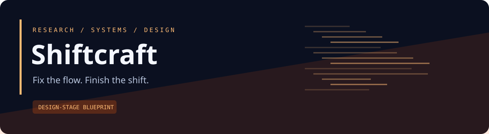
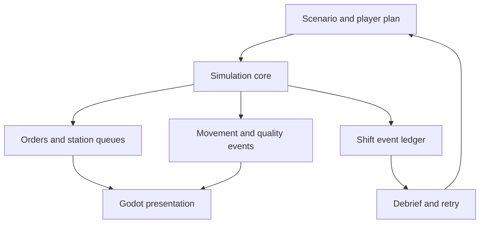

<strong>A factory operations game about bottlenecks, quality, and better decisions.</strong>

Design stage · Documentation first · Open design · No runtime implementation yet

> **Status:** This repository contains an implementation blueprint, architecture, contract specifications, and validation plan. Features below are proposed. There is no installable application, measured performance, trading track record, or completed runtime test suite in this revision. Illustrative scenarios are design examples.

## The problem

Factory games often reward expansion before a player understands why an existing line is struggling. Shiftcraft centers the operational puzzle: orders are late, work piles up, tooling is misplaced, and rework consumes the very capacity needed to recover. The player needs visible causes and a satisfying way to test improvements.

## The proposal

Create a compact 2D single-player operations game in Godot. Players inspect a small production floor, change layout and dispatch rules, run a shift, and review an explainable timeline. Seeded scenarios let players retry the same starting conditions and see the consequences of their decisions.

## A concrete walkthrough

A shift begins with three workstations and a due-time target. Inspection becomes the bottleneck while upstream stations keep producing work in progress. The player pauses, changes release policy and buffer placement, then reruns the same scenario seed. The debrief shows station occupancy, queue time, rework, and each late order’s causal chain. A larger queue is no longer mistaken for more productive work.

## Planned capabilities

| Capability | Why it matters |
| --- | --- |
| Visible production flow | Orders move through stations, buffers, and rework routes |
| Meaningful interventions | Change dispatch, release, inspection, and layout under constraints |
| Seeded retries | Compare decisions from the same initial scenario |
| Causal debrief | Explain lateness with event history and waiting reasons |
| Small authored scenarios | Introduce one operational concept at a time |
| Data-driven progression | Keep scenario and upgrade rules separate from rendering |

## System map

The arrows describe proposed data or control relationships. Detailed ownership and error paths live in the architecture and pipeline specifications.

## Pipeline at a glance

| Stage | Result |
| --- | --- |
| Load scenario | Validated initial shift state |
| Plan intervention | Versioned plan for the attempt |
| Schedule shift | Deterministic logical event queue |
| Process production | Updated orders, queues, and resources |
| Present consequences | Animated floor, queues, warnings, and inspector |
| Debrief | Throughput, lead time, WIP, quality, and cause timeline |
| Retry and progress | New attempt linked to baseline |

## Proposed stack

| Layer | Choice | Reason |
| --- | --- | --- |
| Engine and presentation | Godot stable major selected at implementation | 2D scene tooling and desktop export |
| Game logic | GDScript initially | Accessible iteration with a separate simulation boundary |
| Scenario data | Validated resources or JSON mapping | Versioned authoring without hard-coded level logic |
| Persistence | Versioned local save plus event replay manifest | Explicit attempt and progression state |
| Analysis integration | EconomyLab artifact adapter later | Optional reward and unlock pacing analysis |
| Build verification | Headless scenarios + recorded export presets | Repeatable correctness and packaging checks |

These are design decisions, not an installed dependency inventory. Exact versions, compatibility checks, and lockfiles will be added with the first implementation slice.

## First useful release

Single-player 2D desktop slice with three workstation types, one product route, buffers, one movement model, one quality/rework mechanism, pause and speed controls, three authored scenarios, local saves, seeded retry, and an explanatory end-of-shift report.

**Explicit boundaries:** No initial multiplayer, 3D factory construction, procedural campaign, real industrial training certification, direct employer datasets, large asset marketplace, player trading, or mobile release. EconomyLab integration follows a playable standalone loop.

## Evidence before claims

A headless reference scenario and its rendered version produce equivalent logical outcomes for the same plan and seed. Parts, time accounting, and resource transitions satisfy explicit invariants. Playtests establish whether users understand and enjoy the bottleneck puzzle; simulation correctness alone cannot establish fun.

## Documentation atlas

| Document | What it answers |
| --- | --- |
| [Product specification](docs/PRODUCT.md) | Users, scope, journeys, and measurable requirements |
| [Architecture](docs/ARCHITECTURE.md) | Components, ownership, state boundaries, and deployment |
| [Pipeline specification](docs/PIPELINE.md) | Stage inputs, outputs, checkpoints, and failure behavior |
| [Data model](docs/DATA_MODEL.md) | Entities, units, identities, lifecycle, and invariants |
| [Interfaces](docs/INTERFACES.md) | Integration contracts and domain-specific guarantees |
| [Experience design](docs/UX.md) | Screen behavior, navigation, and a distinctive visual direction |
| [Delivery roadmap](docs/ROADMAP.md) | Milestones with explicit exit criteria |
| [Validation and benchmarks](docs/VALIDATION.md) | Scenario matrix, correctness evidence, and measurement protocol |
| [Operations and recovery](docs/OPERATIONS.md) | Local deployment, diagnostics, recovery, and release behavior |
| [Ecosystem](docs/ECOSYSTEM.md) | Optional connections and independent operation |
| [Architecture decisions](docs/DECISIONS.md) | Choices, alternatives, consequences, and unresolved questions |
| [Source register](docs/SOURCES.md) | Primary references and implementation verification tasks |
| [Implementation handoff](docs/IMPLEMENTATION_HANDOFF.md) | Repository layout, bounded work packages, and review gates |
| [Contract conventions](docs/CONTRACTS.md) | Versioning, provenance, clocks, and numerical representation |
| [Game design and scenario bible](docs/GAME_DESIGN.md) | Domain-specific protocol and worked design |

## Repository organization

| Present now | Planned with implementation |
| --- | --- |
| README, status, domain design documents | game/simulation/ |
| Original SVG identity asset | game/scenes/ |
| Contribution and review templates | game/application/ |

See the [implementation handoff](docs/IMPLEMENTATION_HANDOFF.md) for the complete proposed module hierarchy. Planned directories are intentionally documented rather than filled with empty application scaffolding.

## Working with neighboring projects

EconomyLab can compare supported upgrade and reward pacing. TrailLedger can record reproducible balance experiments and scenario results. The game remains playable without either project, and its production scheduler remains a domain-specific implementation.

All integrations are optional and proposed. The [ecosystem specification](docs/ECOSYSTEM.md) records contract direction, ownership, and the suggested order of integration. A local synthetic fixture must exercise this project's core behavior independently.

## Start here

1. Read the [product scope](docs/PRODUCT.md) and the first milestone in the [roadmap](docs/ROADMAP.md).
2. Review the domain invariants in the [data model](docs/DATA_MODEL.md).
3. Select one work package from the [implementation handoff](docs/IMPLEMENTATION_HANDOFF.md).
4. Produce the associated acceptance evidence before expanding scope.

There are no installation commands yet because no executable release exists. Future setup instructions must be verified from a clean environment.

## Contributing and project state

Use [CONTRIBUTING.md](CONTRIBUTING.md) for proposals and review expectations. [STATUS.md](STATUS.md) distinguishes the completed blueprint from planned engineering work.

**License:** MIT for original repository material; see [LICENSE](LICENSE). Third-party datasets, venue content, game assets, and trademarks retain their own rights.
