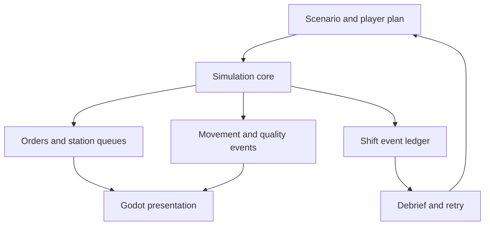

# Shiftcraft — architecture

## Component boundaries

| Component | Owns | Boundary |
| --- | --- | --- |
| Scenario compiler | Routes, floor references, goals, seed policy | Authoring diagnostics before play |
| Simulation scheduler | Logical events, station work, queues | No rendering dependency |
| Production state | Orders, parts, resources, quality routes | Single authority for material state |
| Presentation scenes | Floor animation, selection, sound, overlays | Cannot modify domain state directly |
| Player command layer | Validated plan and supported in-shift actions | Records action time and effect |
| Debrief system | Event-based metrics and causal explanations | Uses measured events, not fabricated narratives |

## State, control, and computation

The logical simulation owns station state, order progress, buffers, travel events, and resource counts. Godot scenes render snapshots and submit validated commands. Logical time is independent of the render frame. Start with a discrete-event scheduler and a simplified deterministic travel model; a pathfinding upgrade must preserve its own explicit assumptions. Separate random streams for processing variability, breakdowns, and defects allow controlled experiments, but a layout change can legitimately alter which events occur.

## Deployment and dependency direction

The first deployment runs locally with explicit data and output directories. Domain logic must execute without a browser UI and without a sibling repository. The UI issues commands through an application boundary and reads materialized results; it never edits raw evidence or canonical domain state directly. File imports enter a staging area, validate, and only then become visible through a manifest.

Start with the fewest processes consistent with the domain. Add a process boundary when isolation, a different language runtime, or measured scheduling interference requires it. Do not introduce Kafka, Kubernetes, a shared remote database, or microservices to satisfy a diagram. Document resource limits, lock ownership, and crash recovery before adding concurrency.

## Fault containment

An impossible route, deadlock, blocked buffer, or exhausted resource produces a visible simulation condition with a causal trace. It must not silently teleport a part or discard work. Corrupt saves are quarantined while prior saves remain available. A missing art asset has a presentation fallback where feasible and never changes production accounting.

## Compatibility and observability

Domain interfaces are detailed in [INTERFACES.md](INTERFACES.md). Every run has an identity, a configuration fingerprint, a source revision, input references, and a terminal status. Diagnostic events link back to the smallest available unit of work. Structured logs carry correlation IDs and exclude credentials. Statistics state their units and observation windows. An operation that cannot establish input completeness must propagate that uncertainty rather than presenting a normal result.

## Extension rules

Adapters translate external formats at the boundary. They cannot redefine canonical semantics implicitly. A new source or execution adapter must pass the same fixture suite as the existing one and document unavailable capabilities. Cross-project contracts are accepted only after a synthetic round trip demonstrates version negotiation, duplicate behavior, and failure isolation.
